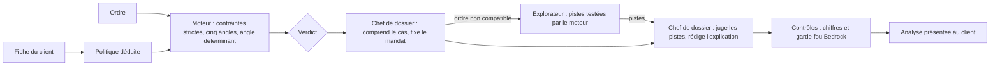
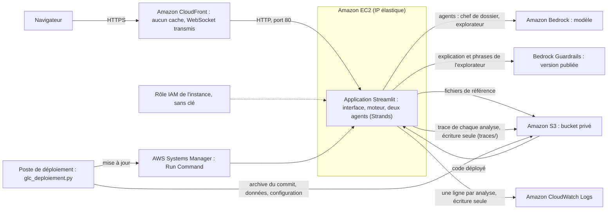

# Sigma

σ, sigma : le symbole du risque en finance.

> Simulation à but éducatif. Aucune transaction réelle. Ceci n'est pas un conseil financier personnalisé.

Les professionnels ont un département de risque. Le particulier n'a que son enthousiasme. Sigma est le prototype d'un service de gestion des risques pour l'investisseur particulier, débutant ou avancé.
Sur un écran de courtage simulé, le client prépare un ordre et clique sur « Analyser l'ordre ». Un moteur de calcul et une équipe de deux agents sur Amazon Bedrock lui disent si l'ordre est compatible avec sa politique de placement, pourquoi, et ce qui est possible.
L'outil renseigne, il ne conseille pas : le client propose, l'outil met l'idée à l'épreuve de ses propres objectifs. Un placement n'est pas une fin en soi, mais un moyen.
Rien ne se compense : chaque angle de l'analyse reçoit une note, et l'angle déterminant, le plus faible, décide du verdict.
Projet réalisé par Rami Houheche pour le Datathon PolyFinances 2026, défi AlphaForge AI.

**Application en ligne :** https://d2401bv4b6xo7h.cloudfront.net/

## Guide d'installation

### Prérequis

- Python 3.13.
- [`uv`](https://docs.astral.sh/uv/) (recommandé) ou `pip`.
- Un accès réseau pour régénérer les données (Yahoo Finance, Banque du Canada, FRED).
- Facultatif : un compte AWS avec accès à Amazon Bedrock dans la région `us-east-1`, pour les agents, le garde-fou et le bucket S3.

### Installation

```bash
git clone https://github.com/rrramoe/sigma.git sigma
cd sigma
uv venv --python 3.13 .venv
uv pip install -r requirements.txt
```

Avec pip : `python3.13 -m venv .venv && .venv/bin/pip install -r requirements.txt`.

Les commandes ci-dessous utilisent `.venv/bin/python` ; activez l'environnement (`source .venv/bin/activate`) pour écrire simplement `python` et `streamlit`.

### Données

Le fichier des prix (`data/prices_daily.csv`) n'est pas publié dans le dépôt : il vient de Yahoo Finance, dont les conditions d'utilisation ne permettent pas de le redistribuer. Régénérez-le avec le script des organisateurs :

```bash
.venv/bin/python data/build_dataset.py
```

Le script télécharge la période du 2021-11-12 au 2026-11-12 et écrit dans `data/` :

| Fichier | Contenu | Dans le dépôt |
|---|---|---|
| `prices_daily.csv` | Prix quotidiens des 31 instruments (Yahoo Finance) | Non, régénéré |
| `corporate_actions.csv` | Dividendes et fractionnements (Yahoo Finance) | Non, régénéré |
| `macro_rates.csv` | Taux et indicateurs (Banque du Canada, FRED) | Non, régénéré |
| `fx_usdcad_daily.csv` | Taux de change USD/CAD (Banque du Canada) | Oui (le script le réécrit) |
| `assets_universe.csv` | Univers des instruments, classes et secteurs | Oui (le script le réécrit) |
| `data_quality_warnings.txt` | Contrôles de qualité du téléchargement | Non |

L'application n'a besoin que de `prices_daily.csv` et des fichiers déjà présents dans le dépôt (`data/` et `reference/`). Les deux autres fichiers servent aux tests et à la reconstruction des fiches d'instruments (`scripts/construire_fiches.py`).

Si vous avez le dossier des organisateurs, vous pouvez aussi y copier les fichiers dans `data/`. Un nouveau téléchargement peut différer légèrement de leur version : Yahoo réajuste `adj_close` à chaque téléchargement. Quelques tests qui figent des notes exactes peuvent alors échouer à la cinquième décimale ; avec les fichiers des organisateurs, ils passent. La variable `GLC_DATA_DIR` permet de lire les données dans un autre dossier.

Le profil détaillé des instruments (`reference/profils_instruments.json`, construit par `scripts/profils_instruments.py` à partir de Yahoo Finance) n'est pas publié non plus. Il est facultatif : sans lui, les champs de profil valent « indetermine ».

### Configuration AWS (facultative)

Aucun identifiant n'est stocké dans le dépôt. Les identifiants AWS viennent de l'environnement, dans cet ordre :

1. les variables `AWS_ACCESS_KEY_ID`, `AWS_SECRET_ACCESS_KEY` et, pour des identifiants temporaires, `AWS_SESSION_TOKEN` ;
2. sinon, un fichier de lignes `export AWS_...=...` hors du dépôt, `~/.aws/datathon.env` par défaut (chemin modifiable par `GLC_AWS_ENV`) ;
3. sinon, la configuration AWS habituelle (`~/.aws/credentials`, profil).

La région est `us-east-1`. Le modèle par défaut est `global.anthropic.claude-sonnet-5` (variable `GLC_MODELE` pour en changer).

Les noms des ressources AWS du projet vont dans un fichier local `glc.env`, ignoré par git :

```bash
cp glc.env.exemple glc.env
.venv/bin/python scripts/verifier_aws.py        # identité et accès aux modèles Bedrock
.venv/bin/python scripts/creer_garde_fou.py     # crée le garde-fou Bedrock, écrit GLC_GARDE_FOU_ID et GLC_GARDE_FOU_VERSION
.venv/bin/python scripts/creer_bucket.py        # crée le bucket S3 privé, y dépose reference/*.json, écrit GLC_BUCKET
```

Les deux scripts de création peuvent être relancés sans risque : ils réutilisent les ressources existantes. Une variable déjà présente dans l'environnement l'emporte sur `glc.env`.

Quand `GLC_BUCKET` est configuré, les fichiers de référence sont lus dans le bucket, pas dans `reference/` : après une modification de `reference/`, relancez `scripts/creer_bucket.py` pour que le bucket et le dépôt restent identiques.

**Sans AWS**, l'application fonctionne : la fiche du client, la politique déduite, le portefeuille, le verdict, la note de chaque angle et l'analyse du moteur s'affichent, avec l'avis « Explication de l'agent indisponible ». Les fichiers de référence sont lus dans `reference/`.
**Il faut AWS** pour l'explication rédigée par les agents, les pistes de l'explorateur, le contrôle du garde-fou et la lecture des références dans S3.

### Lancement

```bash
.venv/bin/streamlit run app.py --server.address localhost
```

L'application s'ouvre sur http://localhost:8501, par une courte introduction qu'on peut passer d'un clic (« Passer l'introduction »), puis par le choix d'un compte : trois comptes prêts, Robert, Mateo et Amira, ou « Nouveau compte », dont la fiche se remplit d'abord (six questions). « Analyser tout de suite un ordre d'exemple » mène directement à un ordre déjà rempli.

Un compte s'ouvre sur son profil (la fiche, puis la politique de placement qui en découle) ; la barre du haut mène ensuite au portefeuille, à « Négocier » et à l'aide, et le menu du compte permet d'en changer. Dans « Négocier », préparez un ordre (instrument, achat ou vente, montant, opération), puis cliquez sur « Analyser l'ordre ». L'analyse donne le verdict, la note de chaque angle et l'angle déterminant, l'explication et les pistes testées.

**Mémoire des analyses.** Une analyse identique (même fiche, même portefeuille, même ordre, mêmes réglages) n'est pas refaite : une analyse en cours est partagée, une analyse finie et réussie est rejouée avec ses étapes, sous la ligne « Analyse déjà faite pour cet ordre ». « Relancer » en demande une nouvelle aux agents. Les analyses gardées vont dans `.cache/analyses.json` (ignoré par git ; `GLC_MEMOIRE_FICHIER` pour un autre chemin) ; `GLC_MEMOIRE=0` désactive la mémoire. `scripts/rechauffer_analyses.py` analyse une fois l'ordre prérempli de chaque compte prêt.

### Tests

```bash
.venv/bin/python -m pytest -q
```

Sans AWS, les tests qui appellent Bedrock, le garde-fou ou S3 sont sautés, de même que ceux qui demandent `corporate_actions.csv`, `macro_rates.csv` ou les profils d'instruments quand ces fichiers manquent. Pour une vérification de bout en bout par l'application elle-même (Bedrock, garde-fou et bucket compris) :

```bash
.venv/bin/python scripts/verifier_demo.py            # tous les cas, environ 5 minutes
.venv/bin/python scripts/verifier_demo.py --rapide   # sans les cas qui appellent les agents
```

## Fonctionnement

1. **La fiche du client** : son objectif, son horizon, les fluctuations qu'il accepte et la perte que sa situation permet, son besoin de liquidités dans l'année, son expérience, ses réponses sur huit thèmes (exclure, éviter, neutre, rechercher, obligatoire) et son portefeuille.
2. **La politique de placement déduite de la fiche** : un profil (le plus prudent entre ce que le client accepte et ce que sa situation permet), des fourchettes par classe d'actif, des plafonds de concentration, des contraintes strictes (thèmes « exclure » ou « obligatoire ») et des préférences souples (thèmes « éviter » ou « rechercher »).
3. **Le modèle de notation** : les contraintes strictes d'abord, puis cinq angles, chacun noté de 0 à 100 : 100 sur la cible, la note de passage exactement à la limite de la politique :
   - **Objectif** : l'ordre sert-il mon objectif ?
   - **Risque** : le risque reste-t-il dans ce que j'accepte ?
   - **Liquidité** : mon argent reste-t-il disponible ?
   - **Diversification** : mon portefeuille reste-t-il bien réparti ?
   - **Préférences** : l'ordre respecte-t-il mes préférences ?

   Chaque angle prend la note de sa mesure la plus faible. L'angle déterminant, celui dont la note est la plus faible, décide du verdict : **compatible**, **en tension** ou **incompatible**. Rien ne se compense.
4. **Deux agents** (Strands Agents sur Amazon Bedrock) : le chef de dossier comprend et dirige, l'explorateur cherche. Le **chef de dossier** lit le cas des deux côtés (le client et l'ordre) et décide s'il faut chercher, et sous quel mandat. Quand l'ordre n'est pas compatible, il peut envoyer l'**explorateur**, qui cherche et teste des pistes sous ce mandat : un montant plus petit, un autre instrument, un achat partagé avec un fonds diversifié, un achat payé par une vente. Le chef de dossier juge ensuite les pistes et rédige l'explication pour ce client.
5. **Ce que le code garde pour lui** : chaque note, chaque verdict et chaque piste testée vient du moteur (`moteur/api.py`), jamais d'un agent. Le code refuse aussi d'envoyer l'explorateur pour un ordre compatible, borne ses essais et vérifie que chaque chiffre de l'explication vient d'un outil. Le détail est dans [`docs/agents.md`](docs/agents.md), l'interface du moteur dans [`docs/api_moteur.md`](docs/api_moteur.md).



## Rôle des services AWS

| Service | Rôle |
|---|---|
| **Amazon Bedrock** | Le modèle de langage des deux agents, le chef de dossier et l'explorateur (`global.anthropic.claude-sonnet-5`, profil d'inférence global, région `us-east-1`). Le rôle de l'instance autorise deux modèles : celui-ci et Amazon Nova 2 Lite. |
| **Strands Agents** | Le kit qui fait des deux agents des agents à outils : appels au moteur, envoi de l'explorateur, suivi des étapes en direct dans l'interface. |
| **Amazon Bedrock Guardrails** | Le garde-fou, appelé dans sa version publiée, refuse le conseil financier personnalisé et les demandes de transaction réelle, et mesure l'ancrage de l'explication dans les résultats des outils (vérification d'ancrage contextuel). Sa configuration est dans `docs/configuration/guardrail-config.json`, identifiants masqués. |
| **Amazon S3** | Un bucket privé (accès public bloqué, chiffrement par défaut, accès refusé hors TLS) garde les fichiers de référence (`reference/*.json`), que l'application lit et qui reviennent au dossier local si S3 ne répond pas ; et, sous le préfixe `deploiement/`, les objets du déploiement : l'archive du code de chaque commit déployé, les données non publiées et la configuration. Sous le préfixe `traces/`, la trace JSON de chaque analyse réellement faite (pas un rejeu de la mémoire) : les étapes des agents, chaque appel d'outil et la réponse du moteur, les contrôles, le verdict et l'angle déterminant, sans les réponses de la fiche ni les poids du portefeuille. La machine y écrit seulement : elle ne peut ni lire, ni lister, ni supprimer une trace. |
| **Amazon CloudWatch Logs** | Une ligne compacte par analyse (identifiant, verdict, angle déterminant, durée, modèles, repli) dans le journal `/garder-le-cap/analyses`, conservé 7 jours, un flux par jour ; la machine peut seulement y écrire. Réglages : `GLC_TRACES=0` éteint les traces (sans bucket, aucune trace), `GLC_JOURNAL_GROUPE` nomme le journal (vide, aucune ligne). La trace s'écrit en fond : si elle échoue, l'analyse n'est ni retardée ni changée. |
| **Amazon CloudFront** | L'adresse publique en HTTPS (certificat par défaut de CloudFront), devant l'instance : le visiteur en HTTP est redirigé vers HTTPS, CloudFront joint l'instance en HTTP sur le port 80, ne garde rien en cache et transmet tout ce que le visiteur envoie, y compris le passage au WebSocket de Streamlit. |
| **Amazon EC2** | L'application publique tourne sur une petite instance Graviton (Amazon Linux 2023), Streamlit en service systemd sur le port 80, le seul port ouvert. Une IP élastique garde la même adresse d'une mise à jour à l'autre. |
| **AWS IAM** | Un rôle propre à l'instance donne ses droits : appel des deux modèles et du garde-fou, lecture du bucket privé (références et déploiement), écriture seule des traces dans S3 et CloudWatch Logs, Systems Manager. Aucune clé n'est posée sur la machine. |
| **AWS Systems Manager** | Run Command amorce l'instance et y passe les mises à jour et les vérifications ; aucun port SSH n'est ouvert. |

Le déploiement est décrit dans [`deploiement/README.md`](deploiement/README.md) et piloté par `deploiement/glc_deploiement.py` : à chaque mise à jour, le code du commit choisi est déposé dans le bucket, l'instance le récupère par Systems Manager, et les fichiers `reference/*.json` de ce commit sont recopiés dans le bucket.



## Sources, hypothèses et limites

Chaque résultat du moteur porte ses sources, publiées ou hypothèses ; la liste complète, avec les dates, est dans [`reference/sources.json`](reference/sources.json).

**Sources principales**

| Élément | Source | Date |
|---|---|---|
| Prix, taux de change, secteurs, dividendes, taux | Jeu de données des organisateurs (Yahoo Finance via yfinance ; Banque du Canada ; FRED) | 2026-11-13 |
| Profils d'investisseur, fourchettes et cibles par classe, pire année et répartition des actions de chaque profil | Financière Banque Nationale – Gestion de patrimoine, documents « Profil d'investisseur » | 2024-09 |
| Plafonds de concentration (15 % par action, 40 % par secteur, 40 % par fonds) | FBN Gestion de patrimoine, politique de placement d'un portefeuille privé | 2022-03 |
| Cibles de cryptoactifs par profil | Fidelity Canada, gamme de FNB tout-en-un | 2026 |
| Exclusions ESG et statut des titres | Vanguard, fonds ESGV (2026-09-30) et VSGX | 2026 |
| Classification du risque de placement | ACVM, Règlement 81-102, Annexe F | 2022-01-05 |
| Capacité à supporter une perte | ACVM, Instruction générale relative au Règlement 31-103, article 13.2 | 2026-01-01 |
| Fourchettes des actions régionales | RBC Gestion mondiale d'actifs, « Global Investment Outlook » | 2025-01 |

**Principales hypothèses** : les trois clients d'exemple, leur profil et leurs portefeuilles sont fictifs ; l'or et la crypto sont des titres alternatifs, `ZST.TO` tient lieu de liquidités ; un achat est payé par l'encaisse et une vente y est versée ; tout est calculé en dollars canadiens, à poids constants rééquilibrés chaque jour ; une échelle commune de 0 à 100, avec la note de passage à la limite de la politique, et la règle de la note la plus faible ; les plafonds d'une seule équipe de gestion sont appliqués à tous les profils.

**Limites** : cinq ans de données, une seule grande baisse, et aucune prévision ; biais du survivant ; le contenu des fonds n'entre pas dans les notes, si bien que la concentration réelle peut être sous-estimée ; le statut ESG est indéterminé pour une partie des titres ; achat sur marge et vente à découvert sont simplifiés (ni coût d'emprunt au-delà des liquidités, ni appel de marge) ; les documents publiés ont pu être révisés depuis leur date.

## Organisation du dépôt

```
app.py                 interface Streamlit (écran de courtage simulé) : monte l'en-tête et la page choisie
interface/             le thème, les composants, les mots, l'état de session et une page par destination
moteur/                moteur de calcul : fiche, politique, notation, simulation ; point d'entrée moteur/api.py
agent/                 les deux agents (Strands), leurs consignes (agent/prompts/), le garde-fou, le suivi en direct
reference/             fichiers de référence : profils, limites, thèmes, clients d'exemple, fiches d'instruments, sources
data/                  univers des instruments, taux de change, script de téléchargement des données
scripts/               création des ressources AWS, vérifications, reconstruction des fiches
docs/                  documentation des agents, du moteur et configuration du garde-fou
tests/                 tests (pytest)
```
